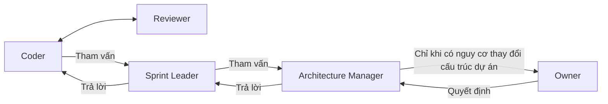

<!-- Records the agreed agent communication design and consultation hierarchy before implementation. -->
# thong-tin-agent

## Trạng thái

Phương án được Owner yêu cầu lưu và cho phép triển khai ngày 2026-10-23.
Schema và adapter đã được nối vào pipeline chung; cần reload API để các lượt
thực thi tiếp theo sử dụng bản mới. Không tự resume ticket đang dừng.

## Mục tiêu

Thống nhất schema trao đổi giữa các agent trước khi sửa prompt và điều phối.
Mỗi yêu cầu đi thẳng vào công việc hoặc quyết định cần giải quyết, giữ kết luận
đã chốt và cung cấp chứng cứ liên quan qua reference. Không tiếp tục chắp vá
prompt riêng theo từng lỗi hoặc từng ticket.

## Nguyên tắc trao đổi đã chốt

- Coder và Reviewer trao đổi hai chiều về finding, sửa chữa, chứng cứ và kết quả review.
- Coder cần tham vấn thì hỏi Sprint Leader (SL); SL trả lời lại Coder.
- SL cần tham vấn thì hỏi Architecture Manager (AM); AM trả lời lại SL.
- Coder và Reviewer không tham vấn trực tiếp AM.
- AM chỉ tham vấn Owner khi có nguy cơ phải thay đổi cấu trúc dự án.
- AM trả quyết định cho SL; SL dùng quyết định đó để làm việc với Coder.
  AM không chuyển thẳng yêu cầu thực hiện cho Coder.
- Node chuyển tiếp, lưu thông điệp, kiểm tra binding và điều phối đúng tuyến;
  không tự thay agent quyết định nội dung chuyên môn.
- Nguyên tắc trao đổi không tự cấp quyền tool, approval hoặc quyền ghi dữ liệu;
  các kiểm tra quyền hiện hành vẫn được giữ nguyên.

## Schema chung dự kiến: 11 trường

Thiết kế chi tiết được trình bày và bổ sung ngày 2026-10-23. Trước khi code,
đối chiếu tên trường, enum và reference với contract/glossary hiện có để dùng
một bộ thống nhất, không tạo hệ điều phối song song.

| Trường | Kiểu | Nội dung và bên quản lý |
| --- | --- | --- |
| `schema_version` | string | Phiên bản contract, dự kiến `"1"`; Node quản lý |
| `message_id` | string | ID thông điệp do Node cấp |
| `in_reply_to` | string hoặc null | ID yêu cầu đang trả lời; Node quản lý |
| `context` | object | `project_id`, `ticket_id`, `execution_id`; Node quản lý |
| `sender` | object | `agent_id`, `role` gửi; Node xác định từ runtime |
| `recipient` | object | `agent_id`, `role` nhận; Node xác định theo tuyến hợp lệ |
| `kind` | enum | Loại trao đổi; agent trả |
| `subject` | string | Một câu nêu vấn đề hoặc kết luận; agent trả |
| `payload` | object | Nội dung theo loại trao đổi; agent trả |
| `evidence` | array | Reference chứng cứ liên quan; agent trả |
| `continuation` | object hoặc null | `assignment_id`, `checkpoint_ref`; Node quản lý |

Node quản lý 7 trường định danh/điều phối; agent tạo 4 trường nội dung.
Agent không tự bịa execution, checkpoint hoặc agent nhận. Envelope hoàn chỉnh
được Node dựng và kiểm tra trước khi chuyển tiếp.

Không nhét toàn bộ lịch sử vào mỗi thông điệp. Dữ liệu đầy đủ vẫn được lưu và
truy xuất chính xác qua reference khi cần. Reference không thay thế quyền đọc
hoặc bằng chứng phê duyệt.

## Payload theo loại trao đổi

`kind` có 7 giá trị dự kiến, phân biệt bằng schema của `payload`:

| `kind` | Trường trong `payload` |
| --- | --- |
| `consultation_request` | `question`, `decision_needed`, `known_decision_refs`, `impact`, `structure_change_risk` |
| `consultation_response` | `outcome`, `answer`, `rationale`, `authority_refs`, `next_steps`, `missing_evidence`, `consultation` |
| `work_request` | `objective`, `criterion_ids`, `decision_refs`, `remaining_work`, `expected_outputs` |
| `work_result` | `outcome`, `summary`, `change_refs`, `verification_refs`, `report_ref`, `remaining_work` |
| `review_request` | `source_ref`, `criterion_ids`, `report_ref`, `finding_refs` |
| `review_result` | `verdict`, `summary`, `findings`, `finding_updates` |
| `correction` | `errors`, `response_ref`, `instruction` |

### Tham vấn và trả quyết định

- `question`, `decision_needed`: string bắt buộc, nêu câu hỏi và quyết định cần chốt.
- `known_decision_refs`: array các quyết định đã có; `impact`: string mô tả ảnh hưởng.
- `structure_change_risk`: object bắt buộc khi AM hỏi Owner, nêu cấu trúc có nguy
  cơ thay đổi, thay đổi dự kiến và căn cứ. Không có căn cứ này thì Node không
  chuyển AM sang Owner.
- `consultation_response.outcome`: `answered`, `needs_evidence` hoặc `needs_higher_authority`.
- `answer`, `rationale`: string; kết luận trực tiếp và căn cứ ngắn gọn.
- `authority_refs`: array reference thẩm quyền; `next_steps`: array bước cụ thể.
- `missing_evidence`: array bắt buộc khi `needs_evidence`; mỗi phần tử có
  `needed`, `needed_for` và `source_ref` nếu đã biết. Không chỉ ghi “điều tra thêm”.
- `consultation`: object bắt buộc khi `needs_higher_authority`, dùng cấu trúc
  payload của `consultation_request`. Node kiểm tra tuyến, điều kiện và dựng
  thông điệp yêu cầu tiếp theo, giữ liên kết với yêu cầu gốc.

### Giao việc, kết quả và review

- Các mục tiêu, kết luận và mô tả phần còn thiếu là string; danh sách tiêu chí,
  bước việc, output và reference là array. Shape reference phải khớp store hiện có.
- `work_result.outcome`: `completed`, `partial` hoặc `blocked`.
- `completed` chỉ xác nhận assignment hoàn thành; không tự đánh dấu ticket
  `done`, thay verdict Reviewer hoặc miễn verification.
- `report_ref` tham chiếu báo cáo đã lưu khi có; nguồn cần review phải xác định
  bằng `source_ref` tới commit/artifact/source phù hợp với contract hiện hành.
- `review_result.verdict` dùng enum verdict hiện hành của Forge; không tạo enum
  khác nghĩa. Reviewer giữ trách nhiệm đánh giá độc lập.
- `findings` chứa phát hiện mới, không tự đặt REV ID; Node cấp ID khi lưu.
  `finding_updates` dùng đúng ID đã tồn tại và contract cập nhật finding hiện hành.
- `correction.errors` là array `{path, code, message}`; `response_ref` xác định
  phản hồi cần sửa; `instruction` yêu cầu sửa đúng schema, giữ kết luận/chứng cứ.

Không bắt AM cung cấp kết quả triển khai thuộc trách nhiệm Coder.

## Reference chứng cứ

Mỗi phần tử `evidence` gồm `type`, `ref`, `purpose` và `sha256` khi loại chứng
cứ yêu cầu hash. `type` dự kiến: `source`, `verification`, `finding`, `report`,
`decision`, `denial`. `ref` dùng identity/path phù hợp với store hiện hành;
`purpose` nêu chứng cứ dùng để xác định điều gì.

Node xác minh reference theo loại. Source tồn tại không thay thế approval.
Không nhúng toàn bộ log, report hoặc finding history vào mỗi lượt trao đổi.

## Ánh xạ phản hồi sang tuyến điều phối

| Yêu cầu hoặc kết quả | Tuyến của Node |
| --- | --- |
| Coder cần tham vấn | SL |
| SL cần tham vấn | AM |
| AM trả lời | SL đã hỏi |
| SL trả lời | Coder đã hỏi |
| Reviewer có finding cần sửa | Coder |
| Coder trả kết quả sửa finding | Reviewer |
| AM cần thẩm quyền cao hơn | Owner, chỉ khi có nguy cơ thay đổi cấu trúc dự án |
| Phản hồi sai schema | Agent sửa tại assignment hiện tại |

`in_reply_to` gắn câu trả lời với đúng yêu cầu, không dùng câu trả lời cũ cho
câu hỏi mới. Trường hành động/kết quả phải được xác minh trước khi chuyển tiếp;
agent đề nghị tuyến không có nghĩa Node được phép thực hiện tuyến đó.

## Kiểm tra của Node

- Kiểm tra tuyến gửi/nhận và thẩm quyền theo nguyên tắc phía trên.
- Gắn câu trả lời với đúng yêu cầu và đúng execution.
- Kiểm tra reference, source binding và quyền truy cập.
- Phân biệt quyết định đã chốt với câu hỏi mới hoặc mâu thuẫn có chứng cứ.
- Yêu cầu bổ sung chứng cứ phải nêu thiếu gì và cần để quyết định điều gì.
- Validator kiểm tra cấu trúc và binding; không suy chất lượng quyết định hoặc
  quyền phê duyệt từ độ giống câu chữ.

## Contract phản hồi và điều phối

- Mỗi agent phải được cung cấp schema phù hợp với role và loại yêu cầu hiện tại:
  trường bắt buộc, giá trị hợp lệ, ý nghĩa hành động và ví dụ tối thiểu.
- Agent trả phản hồi có cấu trúc đúng schema. Forge dựa vào các trường hành động,
  trạng thái kết quả, yêu cầu tham vấn và quan hệ trả lời đã được kiểm tra để
  điều phối bước tiếp theo; không dò từ khóa trong văn xuôi để đoán ý định.
- Forge kiểm tra tuyến và thẩm quyền trước khi thực hiện hành động mà agent đề
  nghị. Agent không thể tự cấp quyền hoặc tự chọn một tuyến bị cấm bằng phản hồi.
- Schema phải phân biệt rõ: đã trả lời, giao thực hiện, cần tham vấn, thiếu chứng
  cứ cụ thể và bị chặn bởi điều kiện thực tế. Tên trường và enum sẽ được chốt
  sau khi đối chiếu contract hiện có, tránh tạo hai bộ ý nghĩa song song.
- Một phản hồi phải nêu kết quả trực tiếp và bước tiếp theo rõ ràng khi còn việc;
  không dùng lời hứa khảo sát hoặc đoạn giải thích dài thay cho quyết định.
- Sai schema thì Forge trả lỗi chỉ rõ trường cần sửa, giữ nguyên yêu cầu,
  checkpoint và chứng cứ. Lỗi định dạng không tự mở lại khảo sát, không được
  coi là quyết định hợp lệ và không tự chuyển sang yêu cầu Owner.

## Prompt sinh từ schema

Prompt tham vấn trình bày theo thứ tự:

1. Câu hỏi hoặc quyết định cần người nhận giải quyết.
2. Những gì đã chốt, không cần khảo sát lại.
3. Chứng cứ liên quan trực tiếp và reference để đọc thêm khi cần.
4. Kết quả cần trả theo schema phù hợp.

Chỉ đưa quy tắc approval, quyền và verification liên quan tới yêu cầu hiện tại.
Chỉ đọc thêm khi cần giải quyết điểm chưa rõ cụ thể. Đủ chứng cứ thì trả quyết định.
Lượt correction do sai định dạng phải giữ kết luận và chứng cứ đã có, yêu cầu
chuyển sang đúng schema thay vì mở lại toàn bộ khảo sát.

Prompt phải yêu cầu mọi agent đi thẳng vào vấn đề: trả lời câu hỏi hoặc nêu kết
quả trước, sau đó cung cấp căn cứ và bước tiếp theo cần thiết. Viết ngắn gọn,
không mở bài xã giao, kể quá trình suy nghĩ, lặp lại lịch sử hoặc diễn giải dài
dòng. Không cắt bỏ thông tin cần thiết cho quyết định, quyền hạn hoặc kiểm chứng
chỉ để đạt độ ngắn. Phần giải thích nằm trong trường tương ứng của schema;
phản hồi điều phối không kèm văn xuôi ngoài payload có cấu trúc.

## Lưu trữ và tiếp tục

Node lưu request/response có ID, quan hệ trả lời và reference đến dữ liệu đầy đủ.
Resume giữ yêu cầu đang xử lý, checkpoint và kết quả đã thu thập; không giao lại
toàn bộ công việc từ đầu. Phản hồi không có tiến triển mới phải được phân biệt
với yêu cầu bổ sung có căn cứ, để điều phối lại đúng người có trách nhiệm.

## Trình tự triển khai dự kiến

1. Khảo sát schema, message stores, prompt builders và các tuyến điều phối hiện có.
2. Lập mapping từ contract hiện hành sang schema trao đổi thống nhất.
3. Bổ sung schema/version và adapter tương thích cho dữ liệu, checkpoint hiện có.
4. Nối các tuyến trao đổi và sinh prompt từ cùng contract.
5. Kiểm thử focused cho tham vấn, trả lời, finding repair, correction, resume,
   tuyến bị cấm và điều kiện AM tham vấn Owner.

Phạm vi áp dụng là pipeline chung cho các ticket, không hardcode ticket hoặc agent ID.

## Triển khai ngày 2026-10-23

- Schema: `schemas/governance/agent-exchange.schema.json` và
  `agent-exchange-payload.schema.json`; giữ 11 trường và 7 loại thông điệp.
- `consultation_response.decision` dùng schema
  `agent-exchange-decision.schema.json` để mang disposition hiện hành; validator
  domain tiếp tục xác minh source, approval, authority và execution thực tế.
- Chuẩn bị proposal chỉ đọc dùng `work_result.candidate`; khi thiếu đầu vào,
  `work_result.consultation` trả câu hỏi về SL. Không tự chuyển sang AM.
- `report_done(status=blocked)` nhận `blocker.consultation` gồm `question`,
  `decision_needed`, `known_decision_refs`, `impact`. `owner_action` cũ được
  adapter chuyển thành quyết định cần hỏi SL; không tự chuyển Owner.
- Shared services: `backend/src/modules/governance/agent-exchange*.js`.
  Thông điệp immutable nằm tại `.forge/runtime/agent-messages/<ticket>/MSG-<hash>.json`;
  mỗi response phải khớp request đã lưu, project và execution.
- Recovery: `blocker-agent-exchange.js`, `blocker-exchange-prompt.js` và worker
  hiện hành. AM trả SL; SL tự quyết định tại Sprint scope, dùng AM delegation
  đã xác minh. AM chỉ được yêu cầu Owner khi có chứng cứ rủi ro thay đổi cấu trúc.
- Coder: `coder-agent-exchange.js` giữ work request trong checkpoint và đọc
  phản hồi SL theo đúng ID khi resume. Tool completion vẫn là nguồn kết quả.
- Review: `review-agent-exchange.js` và worker hiện hành giữ request, kết quả
  gốc, finding identity và giao việc Reviewer → Coder. Node không tự đổi verdict.
- Prompt lấy contract từ schema, đặt câu hỏi hiện tại trước; dữ liệu dài dùng
  index/reference. Correction định dạng tắt discovery, giữ phản hồi và chứng cứ;
  không gửi lại toàn bộ source chỉ để sửa JSON.
- Checkpoint cũ chưa có envelope vẫn được adapter tiếp nhận, không migration.
  Agent gửi lịch sử chưa xác định được có `agent_id=null`; không bịa danh tính.
  Agent nhận yêu cầu phải được resolve trước dispatch.
- Metadata exchange được ghi qua project logger; không thay thế log, report,
  finding store, quyền tool hoặc cơ chế Owner approval hiện hành.

Kiểm chứng tập trung gồm schema/binding, tuyến bị cấm, persistence/restart,
SL → AM → SL → Coder, giữ câu hỏi Coder, sửa định dạng không khảo sát lại,
Reviewer → Coder và resume. Không coi fixture PASS là ticket runtime đã chạy.

Kết quả: 120 test tập trung PASS. Nhóm này loại trừ test Stop đang có lỗi cũ
phát hai `task.failed`; lỗi đó cũng tái hiện khi vô hiệu hóa lớp exchange mới.
Chưa restart API, resume ticket thật, commit hoặc push trong thay đổi này.

Hậu kiểm lượt AM ngày 2026-10-23: schema envelope đã cấm loại evidence ngoài
enum, nhưng prompt ban đầu chỉ mô tả hình dạng `{type,ref,purpose}` mà không
in enum đó. Diagnostic enum cũng không trả các giá trị hợp lệ, khiến lượt
correction phải tự đoán. Prompt hiện lấy evidence definition trực tiếp từ
envelope schema; validator trả danh sách giá trị hợp lệ trong diagnostic.
